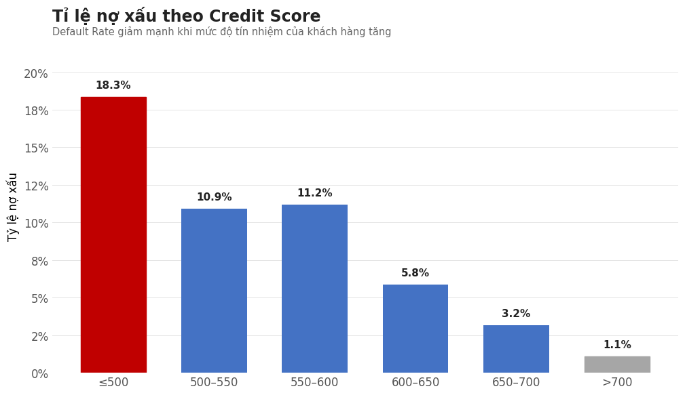
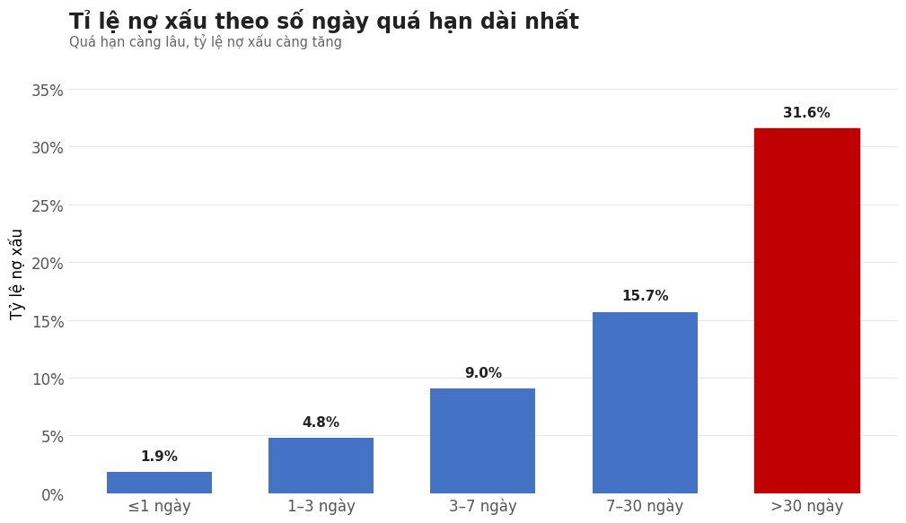
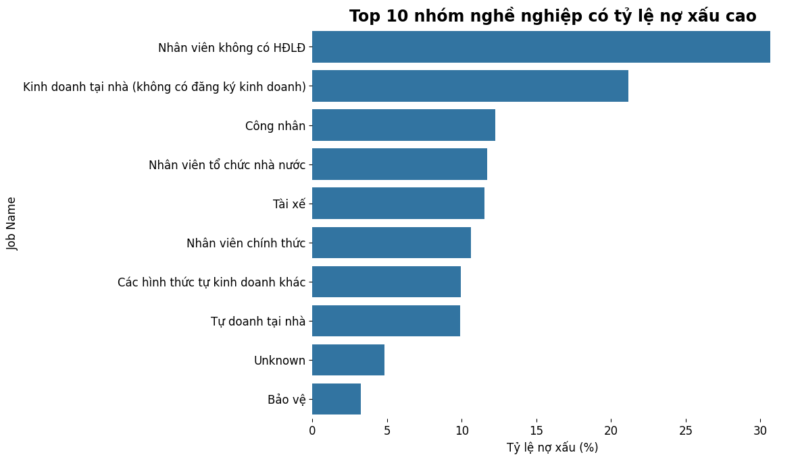
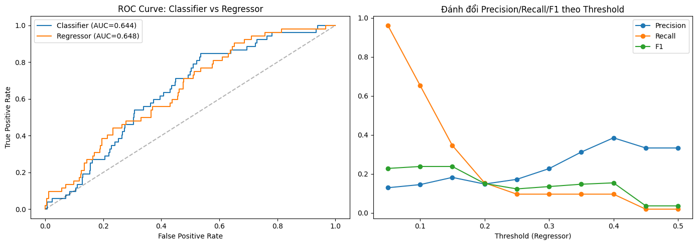

# TIMA Credit Risk Analysis

End-to-end analysis of a consumer-lending portfolio (2,383 loans, 2016–2019) from a Vietnamese P2P/pawn-loan platform: data cleaning → SQL exploration → Power BI dashboard → bad-debt diagnostics → bad-debt prediction baseline → business recommendations.

> Final project, Data Analysis course at Rikkei Academy/HUST.

> **My role:**  data cleaning, SQL queries, Power BI pages, ML notebook

## Business questions

1. How large is the loan book and how well is capital being disbursed (by product, time, region)?
2. Where is credit risk concentrated (overdue, bad debt) by product, district and customer group?
3. Who are the customers (income, occupation, residence, loyalty) and which segments are safe?
4. Which signals are associated with bad debt, and can a simple model flag risky applicants?
5. What portfolio and policy changes would reduce risk without cutting volume?

## Tech stack

Python (pandas, NumPy, scikit-learn, matplotlib, seaborn) · SQL Server / T-SQL · Power BI (3-page report) · PowerPoint

## Repository structure

```
├── data/
│   ├── README.md                      # data dictionary, privacy notes
│   └── sample/                        # 100-row anonymised sample (no PII)
├── notebooks/
│   ├── 01_data_cleaning.ipynb         # raw CRM export -> Tima_clean.csv
│   ├── 02_random_forest_bad_debt.ipynb# classifier vs regressor baseline
│   └── 03_diagnostic_analysis.ipynb   # what is associated with bad debt?
├── sql/                               # 50+ T-SQL queries in 10 topic files (00_ = setup)
├── powerbi/                           # dashboard screenshots
└── reports/
    ├── TIMA-Final-Project-Report.pptx
    └── figures/                       # charts exported from the notebooks
```

## 1. Data cleaning (`01_data_cleaning.ipynb`)

Raw CRM export: 2,383 rows × 49 columns → cleaned: 2,383 rows × 46 columns, 0 duplicate rows.

- Dropped three duplicate money columns; kept requested amount, disbursed amount, remaining principal (cast to integer).
- `Gender` 0/1 → Male/Female; `Salary` parsed to numeric (text such as "ten thousand", `$` and thousand separators handled); dates parsed with invalid values (e.g. 2023-02-30) → missing.
- Birthdays implying age < 18 or > 100 at application time → missing.
- Impossible values → missing: `LongestOverdue < 0` (49 rows), residence duration `-1`, `NumberOfLoans < 0`; `HasBadDebt` / `HasLatePayment` restricted to {0, 1}.
- Text columns trimmed, empty strings → missing; high-missing categorical columns filled with `Unknown`. Numeric/date gaps are left missing.

## 2. SQL exploration (`sql/`)

Written for SQL Server against a table `tima_clean`. Load `Tima_clean.csv` into that table and run `00_post_processing.sql` first. Techniques: CTEs, `CASE` bucketing, window functions (`ROW_NUMBER`), self-joins, `HAVING` thresholds, `NULLIF` / `COALESCE` guards.

## 3. Power BI dashboard

Three pages — **Overview**, **Credit Risk**, **Customer Segment** — with KPI cards, slicers, combo/column/bar charts and detail tables. Screenshots: see `powerbi/`.

## 4. Portfolio findings

> **Two different "bad debt" measures are used in this project — they are not the same thing.**
>
> | Measure | Column | Meaning | Rate |
> |---|---|---|---|
> | **Current bad-debt rate** | `Trạng thái = 'Nợ Xấu'` | Tima's own loans currently classified as bad debt | **8.64%** (206 / 2,383 loans) |
> | **Customer bad-debt history** | `HasBadDebt` (CIC flag) | Customer has a bad-debt record in the credit-bureau check | **10.99%** (262 loans) |
>
> The diagnostics and most SQL queries use the current bad-debt rate; the ML notebook predicts the customer bad-debt history.

| Topic | Finding |
|---|---|
| Disbursement | ₫28.0bn disbursed of ₫30.5bn requested (**91.6%**). Stable at 91–93% in 2016–2018, then **54.7% in 2019**. |
| Products | Phone pawn is the largest product (**46.6%** of loans). Car-registration loans carry remaining balance above disbursed principal (accrued penalty interest). SIM-backed loans: few contracts, high concentration, highest bad-debt rate. |
| Risk size | Current bad-debt rate **8.64%**. CIC history flags: bad-debt history on **10.99%** of loans, late-payment history on **14.10%**; together **25.09% of loans** (no overlap). |
| Loyalty | Repeat borrowers (6–12 loans) are all in the low-risk band. |
| Geography | Highest CRS in Ho Chi Minh City (avg 624); Hoàn Kiếm and Hà Đông have the highest bad-debt rates in Hanoi. |

## 5. Bad-debt diagnostics (`03_diagnostic_analysis.ipynb`)

Target: **current bad debt** — loan status `Nợ Xấu` (8.64%, 206 of 2,383 loans). Customer bad-debt history (`HasBadDebt`) is used as one of the signals.

| Signal | Result (current bad-debt rate) | Correlation with current bad debt |
|---|---|---|
| Credit score | Bad-debt rate falls from 18.3% (score < 500) to 1.1% (> 700) | −0.20 |
| Customer bad-debt history (CIC) | Higher current bad-debt rate for customers with a prior record | +0.12 |
| Longest overdue | 33.0% bad-debt rate when overdue > 30 days vs 7.7% otherwise | +0.20 |
| Salary | Weak relationship; top income quartile 5.3% vs 9–11% for the others | −0.05 |
| Loan amount | Larger loans do **not** mean more bad debt (hypothesis rejected) | −0.05 |
| Occupation (n ≥ 30) | Informal workers highest: no labour contract 30.7%, unregistered home business 21.2%; formal employees 10.6% | – |

**Risk-flag accumulation.** Flags: credit score ≤ 550, prior CIC bad debt, overdue > 30 days.

| Flags | Loans | Bad-debt rate |
|---|---|---|
| 0 | 1,471 | 4.4% |
| 1 | 759 | 13.4% |
| 2 | 143 | 23.8% |
| 3 | 10 | 50.0% |

Customers with ≥ 2 flags have a 25.5% bad-debt rate, 5.8× the zero-flag group.

| | | |
|---|---|---|
|  |  |  |

## 6. Bad-debt prediction baseline (`02_random_forest_bad_debt.ipynb`)

Target: **customer bad-debt history** (`HasBadDebt`, 10.99% positive) — i.e. whether an applicant already has a bad-debt record in the credit-bureau check, not whether the loan becomes bad debt at Tima. Random Forest classifier vs regressor, 11 features, 80/20 stratified split, `random_state=42`.

| Model | ROC-AUC | Precision (bad) | Recall (bad) | F1 (bad) |
|---|---|---|---|---|
| RF Classifier (threshold 0.5) | 0.644 | 0.111 | 0.096 | 0.103 |
| RF Regressor (threshold 0.1) | 0.648 | 0.145 | 0.654 | 0.238 |



**Takeaway:** discrimination is weak (AUC ≈ 0.64). Lowering the threshold trades precision for recall (the regressor catches 65% of bad loans while flagging many good ones). Next steps: resampling (SMOTE), customer-level splits, cost-based threshold tuning, and retraining on the current bad-debt status (`Nợ Xấu`) to predict default on Tima's own loans.

## 7. Recommendations

- Hard credit-score gate: no limits > ₫500M when score < 600.
- Require 3–6 months of bank statements for car and SIM-backed loans, and for informal-income applicants.
- Expand lending where quality is higher (Ho Chi Minh City); tighten review in Hoàn Kiếm and Hà Đông.
- Reward repeat borrowers (≥ 3 loans) with preferred rates.
- Targets: average overdue < 30 days; risk-zone share < 5%; restore disbursement rate to ~90%.

## Limitations

- Small dataset (2,383 loans, ~1,870 unique customers); results are descriptive, not causal.
- The ML model predicts the customer's external bad-debt history, not default on Tima's loans; it is a screening baseline only.
- The ML train/test split is by row, so the same customer can appear in both sets; some features (remaining-principal ratio, days remaining) may leak loan outcome.
- The risk-flag score uses "overdue > 30 days", which is closely tied to how bad debt is assigned, so part of its lift is circular.
- About 164 loans have a declared salary below ₫1M (likely unit errors such as "10,000"); salary-based results should be read with care.
- Credit-score bins in notebook 03 use right-open intervals, so the "≤500" label actually means < 500.

## How to run

```bash
pip install -r requirements.txt
# put the raw CSV in data/ (not published; see data/README.md), then run in order:
jupyter notebook notebooks/01_data_cleaning.ipynb   # writes data/Tima_clean.csv
jupyter notebook notebooks/02_random_forest_bad_debt.ipynb
jupyter notebook notebooks/03_diagnostic_analysis.ipynb
```

## Data & privacy

The source data are real loan records. All personal identifiers (names, phone numbers, ID numbers, addresses, employers) are excluded from this repository. Only an anonymised 100-row sample is provided.
